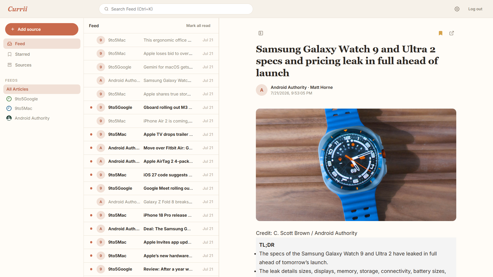

# Currii

A self-hosted RSS and Atom feed reader with a bookmarked reading list and a guest mode.

## Course Information

| | |
| :--- | :--- |
| Course | System Analysis and Design |
| Program | Information Technology |
| Year Level | 2nd Year |
| Term | Summer |

Currii was an older project that had been set aside. It was revisited and updated for this course.

## About

Currii lets you follow feeds by URL and read them in one list. Registered users can bookmark articles and save their preferences. Guests can try the app without signing up, using a temporary list of sources that is never written to the database.

## Features

### Reading

- **Add by URL:** Enter any site or feed URL. Currii detects RSS or Atom, retrieves the title, favicon, and site link, and starts tracking the feed.
- **Combined feed:** All subscriptions appear in one chronological list, which can be filtered by source or search term.
- **Full article fetch:** If a feed only provides a short excerpt, opening the article fetches the full page and caches it.
- **Read status and bookmarks:** Articles are marked as read automatically. You can bookmark articles to a reading list or mark everything as read at once.

### Guest mode

- Guests can browse and add sources without an account. Their source list lasts only for the session.
- Registering adds bookmarks, notifications, and saved preferences.

### Sources

- **Source manager:** Add, remove, and group feeds into categories. Each source shows its status (Online, Offline, or Invalid) and can be refreshed manually.
- **Shared feed cache:** Each feed is fetched and parsed once and shared between all subscribers.

### Interface

- Collapsible feed list
- Light, dark, and system themes
- Adjustable font size
- Keyboard-driven command palette
- Monochrome design with a compact, single-line article list that gives titles priority over preview text

## Tech Stack

| Layer | Technology |
| :--- | :--- |
| Backend | PHP (no framework, MVC structure) |
| Database | MySQL via PDO |
| Frontend | HTML, CSS, JavaScript |
| Local server | Laragon (Apache and MySQL) |

## Installation

### Prerequisites

- [Laragon](https://laragon.org/) with Apache and MySQL
- A web browser

### Steps

1. **Copy the project.** Place the `currii` folder in your Laragon `www` directory, for example `C:\laragon\www\currii`. If you already have a project with the same name in `www`, rename one of them.

2. **Import the database.** Open phpMyAdmin or the Laragon MySQL terminal and import `database/schema.sql`. This creates the `currii` database and its tables. No sample data is needed.

3. **Start the servers.** Start Apache and MySQL in Laragon.

4. **Open the app.** Go to `http://localhost/currii/public/`, or `http://currii.test` if Laragon's automatic virtual hosts are enabled.

## Usage

There are no sample accounts. You can either:

- Click **Continue as Guest** to use the app right away with a temporary source list, or
- **Create an account** to keep your subscriptions, bookmarks, and preferences.

Account requirements:

| Field | Requirement |
| :--- | :--- |
| Username | 3 to 30 characters: letters, numbers, underscores, and periods |
| Password | At least 8 characters |

## Security

- Every API action is checked by `Security::requireAuth()` (registered users and active guests) or `Security::requireRegistered()` (registered users only, such as bookmarks and notifications).
- Queries that use user input are written as PDO prepared statements to prevent SQL injection.
- Passwords are hashed with Argon2id, falling back to bcrypt, using `password_hash()` and checked with `password_verify()`.
- Sessions are regenerated on login to prevent session fixation. Requests that change data require a per-session CSRF token.
- Login and registration attempts are rate-limited per session to slow down brute-force attacks.
